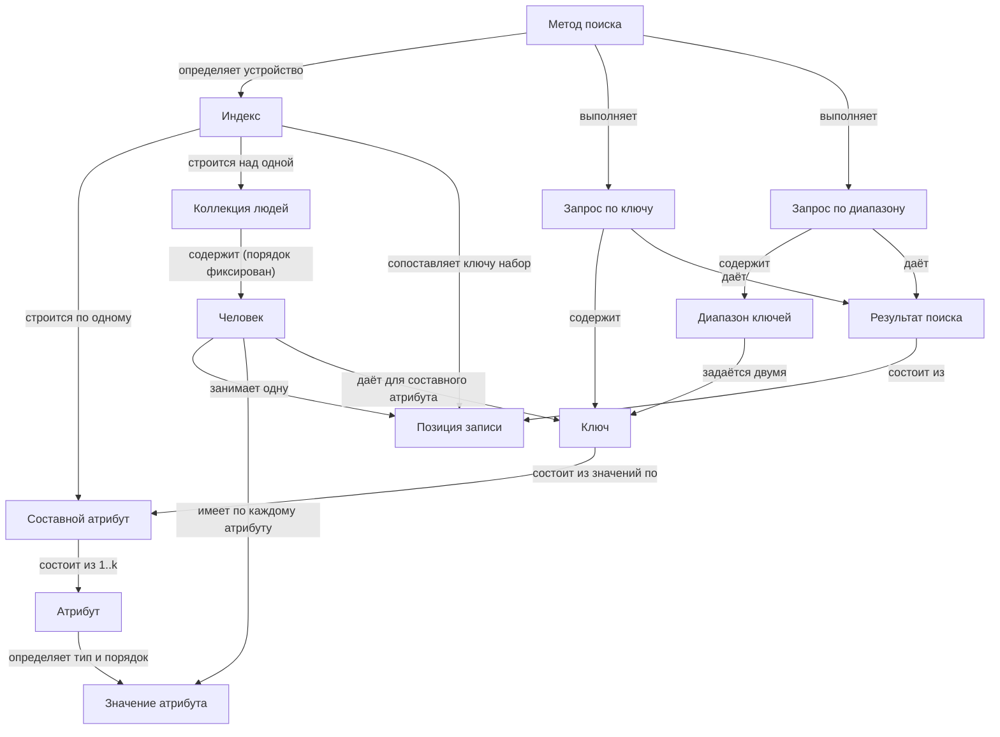
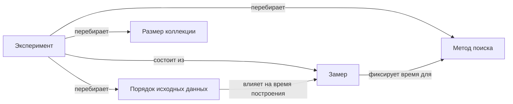
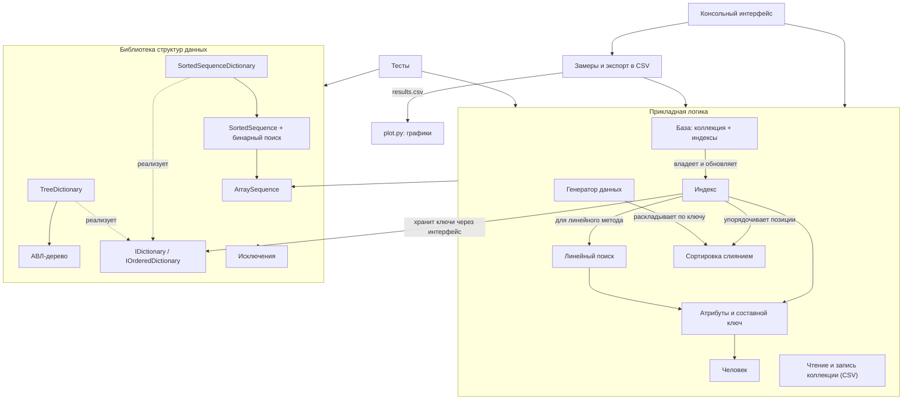

# ЛР-2. Дизайн (техническое задание)

**Курс:** информатика (организация и поиск данных), 3 семестр, НИЯУ МИФИ.
**Тема:** индексирование данных и сравнение алгоритмов поиска.

---

## 1. Постановка задачи

### 1.1. Что делается в работе

Есть большая коллекция записей о людях: фамилия, имя, отчество, год рождения. Порядок записей фиксирован, переставлять их нельзя. Требуется быстро находить людей:
- **по точному значению ключа**, например всех Ивановых или всех, кто родился в 1995 году;
- **по диапазону значений**, например всех, кто родился с 1990 по 2000 год, или всех, чья фамилия лежит между «К» и «М»;
- **по составному ключу**, то есть по набору из нескольких атрибутов сразу, например (фамилия, имя, год рождения).

Для этого над коллекцией строится **индекс**: вспомогательная структура, которая по значению ключа сразу указывает, где в коллекции лежат подходящие записи. Сама коллекция при этом не меняется.

Индекс строится двумя методами поиска, и они сравниваются между собой и с простым перебором:

| Метод | Как устроен индекс | Поиск по ключу | Поиск по диапазону |
|---|---|---|---|
| **Линейный поиск** (эталон) | индекса нет, перебираются все записи | O(n) | O(n) |
| **Бинарный поиск** | отсортированная последовательность ключей, у каждого ключа список позиций | O(log n) | O(log n + k log k) |
| **АВЛ-дерево** | сбалансированное дерево поиска, в узле ключ и список позиций | O(log n) | O(log n + k log k) |

Здесь n — число записей, k — число найденных. Сам поиск диапазона в структуре занимает O(log n + k); слагаемое k log k — это упорядочивание найденных позиций, чтобы результат у всех методов был в одном виде (см. п. 3.3 «Индекс»).

Программа позволяет:
- загрузить, ввести вручную или сгенерировать коллекцию;
- выбрать атрибут или набор атрибутов и метод, построить индекс, выполнить поиск;
- посмотреть исходные данные и результат;
- измерить время построения индекса и время поиска;
- сравнить методы на одних и тех же данных в трёх случаях: данные уже упорядочены по ключу, упорядочены в обратном порядке, не упорядочены;
- выгрузить результаты замеров в CSV и построить графики.

### 1.2. Зачем это нужно

Это общий класс задач **быстрого поиска записей по значениям их полей без перестановки самих данных**:
- индексы в базах данных: таблица хранится как есть, а для часто используемых полей заводятся индексы, в том числе составные и с поиском по диапазону (`WHERE year BETWEEN 1990 AND 2000`);
- справочники и картотеки: поиск человека по ФИО, по году рождения, по нескольким признакам сразу;
- несколько независимых «взглядов» на одни и те же данные: один список людей можно одновременно искать и по фамилии, и по возрасту, не копируя записи;
- выбор структуры данных под нагрузку: сравнение показывает, когда достаточно перебора, когда выгоднее отсортированный массив, а когда дерево.

### 1.3. Состав задачи (59 баллов при пороге 55)

| Раздел | Пункт | Баллы |
|---|---|---|
| Задача | И-5. Индексирование данных | 7 |
| | И-5.1. Поиск по диапазону значений | 5 |
| | И-5.2. Индексирование составных атрибутов | 7 |
| Метод 1 | М-2. Бинарный поиск по отсортированной последовательности | 10 |
| | ISortedSequence на базе Sequence | 3 |
| Метод 2 | М-3. Бинарное дерево | 15 |
| | М-3.1. Сбалансированное (АВЛ) | 7 |
| | IDictionary на базе бинарного дерева | 5 |
| **Итого** | | **59** |

---

## 2. Сущности прикладной задачи

### 2.1. Сущности

#### Данные

| Сущность | Описание |
|---|---|
| **Человек** | Запись в коллекции: уникальный номер, фамилия, имя, отчество, год рождения. |
| **Коллекция людей** | Упорядоченный набор записей. Порядок задан при загрузке или вводе и не меняется: сортировать коллекцию запрещено условием задачи. Записи можно только добавлять в конец. |
| **Позиция записи** | Номер записи в коллекции (с нуля). Позиция однозначно указывает на человека и не меняется, пока коллекция не перезагружена. |

#### Атрибуты и ключи

| Сущность | Описание |
|---|---|
| **Атрибут** | Свойство человека, по которому можно искать. Имеет имя, тип значения (строка или целое число) и порядок сравнения. Набор атрибутов фиксирован (см. таблицу ниже). |
| **Значение атрибута** | Значение свойства у конкретного человека, например «Иванов» или 1995. |
| **Составной атрибут** | Упорядоченный набор из одного или нескольких атрибутов, например (фамилия, имя, год рождения). Простой атрибут считается составным из одного элемента. |
| **Ключ** | Набор значений составного атрибута у одного человека, например («Иванов», «Пётр», 1995). Ключи сравниваются **лексикографически**: по первому атрибуту, при равенстве по второму и так далее. |
| **Диапазон ключей** | Пара ключей «нижняя граница, верхняя граница», обе включаются. Нижняя граница не больше верхней. |

Атрибуты человека:

| Атрибут | Тип | Порядок | Пример |
|---|---|---|---|
| Номер | целое | числовой | 17 |
| Фамилия | строка | словарный | Иванов |
| Имя | строка | словарный | Пётр |
| Отчество | строка | словарный | Сергеевич |
| Полное имя | строка | словарный | Иванов Пётр Сергеевич |
| Фамилия И.О. | строка | словарный | Иванов П.С. |
| Год рождения | целое | числовой | 1995 |
| Возраст на заданный год | целое | числовой | 29 (на 2024 год) |

Возраст зависит от года, на который он считается. Этот год задаётся при выборе атрибута, например «возраст на 2019 год», как в примере из задания.

#### Поиск

| Сущность | Описание |
|---|---|
| **Индекс** | Связь «ключ → позиции всех записей с этим ключом», построенная по одному составному атрибуту над одной коллекцией. Над одной коллекцией может быть несколько индексов по разным атрибутам. |
| **Метод поиска** | Способ найти записи: линейный перебор коллекции, бинарный поиск по отсортированной последовательности ключей или поиск в АВЛ-дереве. Последние два хранят индекс, первый работает прямо с коллекцией. |
| **Запрос по ключу** | Найти все записи, у которых ключ равен заданному. |
| **Запрос по диапазону** | Найти все записи, у которых ключ лежит в заданном диапазоне. |
| **Результат поиска** | Набор позиций найденных записей, по которым можно показать самих людей. Может быть пустым. |

#### Сравнение методов

| Сущность | Описание |
|---|---|
| **Порядок исходных данных** | Как записи расположены в коллекции относительно ключа индекса: по возрастанию, по убыванию, в случайном порядке. От этого зависит время построения индекса. |
| **Замер** | Время одной операции (построение индекса, поиск по ключу, поиск по диапазону) для заданного метода, размера коллекции и порядка данных. |
| **Эксперимент** | Серия замеров для нескольких размеров коллекции, всех методов и трёх видов порядка данных на одних и тех же данных. Результат — таблица, которую можно выгрузить в CSV. |

### 2.2. Связи между сущностями

Смысл ключевых связей:
- **Индекс указывает на позиции, а не хранит людей.** Поэтому индексов может быть сколько угодно, данные не копируются, а коллекция не меняется.
- **Один ключ — много позиций.** У многих людей одинаковая фамилия или год рождения, поэтому ключ сопоставляется набору позиций, а не одной.
- **Простой атрибут — частный случай составного.** Это позволяет одинаково строить и искать индексы любого вида.
- **Метод поиска определяет только устройство индекса.** Запросы и результаты одинаковы для всех методов, поэтому методы можно сравнивать на одних и тех же запросах и проверять друг по другу.

---

## 3. Архитектура

### 3.1. Компоненты

| Компонент | Назначение |
|---|---|
| **Консольный интерфейс** | Меню: ввод и загрузка данных, генерация, просмотр, выбор атрибутов и метода, поиск, замеры, сравнение, экспорт. Перехватывает ошибки и показывает понятные сообщения. |
| **Прикладная логика** | Человек, атрибуты, составные ключи, индекс, линейный поиск, генератор данных, чтение и запись коллекции в файл. |
| **Библиотека структур данных** | Шаблонные структуры, не зависящие от задачи: динамическая последовательность, пара, отсортированная последовательность с бинарным поиском, АВЛ-дерево, словари на их основе, исключения. |
| **Замеры** | Измерение времени, проведение эксперимента, запись результатов в CSV. Скрипт на Python строит графики по CSV. |
| **Тесты** | Модульные тесты библиотеки и прикладной логики (GoogleTest). Интерфейс не тестируется. |

### 3.2. Связи между компонентами

Зависимости направлены в одну сторону: интерфейс знает о логике, логика о библиотеке, а библиотека ни о чём из задачи не знает. Поэтому структуры данных можно тестировать отдельно и использовать с любыми типами.

### 3.3. Описание компонентов, алгоритмов и решений

#### Динамическая последовательность `ArraySequence<T>`
Массив в динамической памяти с запасом ёмкости. При заполнении ёмкость удваивается, поэтому добавление в конец в среднем стоит O(1). Вставка в середину сдвигает хвост: O(n). Используется везде, где нужен список: позиции записей в индексе, результаты поиска, сама коллекция людей.

#### Пара `Pair<K, V>` и правила сравнения
Пара «ключ, значение»; пары равны, если равны и ключи, и значения. Упорядоченные структуры получают правило сравнения параметром шаблона: по умолчанию `Less<T>` (обычный `<`), для пар — `PairKeyLess` (только по ключу).

#### Метод 1. Отсортированная последовательность и бинарный поиск
`SortedSequence<T>` реализует `ISortedSequence<T>` по спецификации из задания и хранит элементы в `ArraySequence<T>` по возрастанию.

- **Бинарный поиск нижней границы** (`LowerBound(x)`): первая позиция, где элемент не меньше `x`. Отрезок поиска на каждом шаге делится пополам: O(log n). Через него выражаются все остальные операции.
- **Верхняя граница** (`UpperBound(x)`): первая позиция, где элемент больше `x`.
- **Поиск по ключу**: `LowerBound(x)`, затем проверка, что найденный элемент равен `x`.
- **Поиск по диапазону [a, b]**: элементы с позиции `LowerBound(a)` до `UpperBound(b)` (не включая её): O(log n + k).
- **Добавление** (`Add`): место находится бинарным поиском, затем хвост сдвигается на одну позицию.

Время построения через последовательные `Add` зависит от порядка данных, и это как раз один из предметов сравнения:

| Порядок данных | Что происходит | Построение |
|---|---|---|
| по возрастанию | каждый новый элемент встаёт в конец, сдвигов нет | O(n log n) |
| по убыванию | каждый новый элемент встаёт в начало, сдвигается всё | O(n²) |
| случайный | в среднем сдвигается половина | O(n²) |

`SortedSequenceDictionary<K, V>` реализует `IOrderedDictionary<K, V>`. Ключи хранятся в `SortedSequence<K>` (уникальные, по возрастанию), значения в параллельном `ArraySequence<V>`: значение ключа с позицией i лежит на той же позиции i. `SortedSequence::Insert` возвращает позицию вставленного ключа, и значение вставляется туда же. Так значение можно менять на месте (индекс дописывает позицию в список), а ключ снаружи изменить нельзя, и порядок не нарушится.

#### Метод 2. АВЛ-дерево
`AvlTree<T>` — шаблонное бинарное дерево поиска, в котором высоты левого и правого поддерева любого узла различаются не больше чем на 1. Узел хранит значение, указатели на детей и свою высоту.

- **Вставка**: спуск от корня, как в обычном дереве поиска, затем на обратном пути пересчёт высот и при нарушении баланса один из четырёх поворотов (малый левый, малый правый, большой левый, большой правый). O(log n).
- **Удаление**: обычное удаление из дерева поиска (лист, узел с одним ребёнком, узел с двумя детьми через минимальный элемент правого поддерева), затем перебалансировка на обратном пути. O(log n).
- **Поиск по ключу**: спуск от корня. O(log n), потому что высота АВЛ-дерева не больше примерно 1,44·log₂ n.
- **Поиск по диапазону [a, b]**: симметричный обход, который не заходит в левое поддерево, если значение узла меньше `a`, и в правое, если оно больше `b`. O(log n + k).
- **Построение**: отдельный класс `TreeBuilder` вставляет элементы последовательности по одному (как рекомендует задание: не статический метод дерева, чтобы не связывать дерево с последовательностью). Благодаря балансировке построение занимает O(n log n) при любом порядке данных. У дерева без балансировки упорядоченные данные дали бы вырождение в список и O(n²).

`TreeDictionary<K, V>` реализует `IOrderedDictionary<K, V>`: в дереве хранятся `Pair<K, V>`, сравнение по ключу.

#### Интерфейсы словарей
- `IDictionary<K, V>` повторяет спецификацию из задания: `GetCount`, `GetCapacity`, `Get`, `ContainsKey`, `Add`, `Remove`.
- `IOrderedDictionary<K, V>` расширяет его поиском по диапазону: `GetRange(low, high)` возвращает пары с ключами в диапазоне по возрастанию ключа.

Индекс работает только через `IOrderedDictionary`, поэтому метод выбирается при построении индекса, а код поиска один для обоих методов.

#### Составной ключ `CompositeKey`
Набор значений атрибутов, каждое из которых — строка или целое число. Сравнение лексикографическое: по первому значению, при равенстве по второму и так далее. Ключ собирается во время работы программы по списку атрибутов, который выбрал пользователь. Поэтому используется своя структура, а не `std::tuple`, у которого состав задаётся при компиляции.

#### Индекс `Index`
Хранит описание составного атрибута, указатель на коллекцию и метод поиска. Для бинарного поиска и АВЛ-дерева создаётся словарь `IOrderedDictionary<CompositeKey, ArraySequence<size_t>>`: ключ → позиции всех записей с этим ключом. Для линейного метода словаря нет, запросы передаются линейному поиску. Так все три метода выбираются одинаково, а замеры и интерфейс работают с ними через один класс.

- **Построение** (в конструкторе, поэтому время построения — время создания индекса): для каждой записи по порядку вычисляется ключ. Если ключ уже есть, позиция дописывается в его список, иначе в словарь добавляется новый ключ. Позиции в каждом списке идут по возрастанию. Если у какой-то записи ключ вычислить нельзя (возраст на год раньше года рождения), индекс не создаётся и бросается `InvalidArgument`.
- **Поиск по ключу**: одно обращение к словарю.
- **Поиск по диапазону**: `GetRange`, затем списки позиций всех ключей объединяются и упорядочиваются сортировкой слиянием: O(k log k).
- **Результат любого запроса — позиции по возрастанию** у всех трёх методов. Поэтому результаты разных методов сравниваются простым равенством, а пользователь видит людей в порядке коллекции.
- **Добавление записи в коллекцию**: позиция новой записи добавляется во все построенные над коллекцией индексы.

#### База `Database`
Владеет коллекцией людей и всеми индексами над ней и держит их согласованными:
- добавление человека сначала проверяет, что его ключ вычисляется для всех индексов, затем дописывает его в коллекцию и в индексы; при ошибке ничего не меняется;
- замена всей коллекции (загрузка, генерация) строит новые индексы с теми же атрибутами и методами; если хотя бы один построить нельзя, остаются старые данные и старые индексы.

Базу нельзя копировать: индексы хранят указатель на её коллекцию.

#### Линейный поиск
Перебирает коллекцию, вычисляет ключ каждой записи и сравнивает его с запросом. Индекса нет, построение ничего не стоит, поиск O(n). Служит эталоном: на тестах и по команде пользователя результаты обоих методов сверяются с ним.

#### Сортировка слиянием
Устойчивая сортировка `ArraySequence` за O(n log n) при любых данных. Используется индексом (упорядочить позиции результата диапазона) и генератором (разложить записи по ключу). Саму коллекцию людей она не трогает.

#### Генератор данных
Создаёт n людей из списков фамилий, имён и отчеств с годами рождения в заданном интервале. Пол выбирается случайно и согласуется с формой фамилии и отчества (Иванов Пётр Сергеевич, Иванова Анна Сергеевна). Номера записей 1..n.

Для экспериментов генератор выдаёт записи в нужном порядке по выбранному атрибуту: по возрастанию, по убыванию или в случайном. Для упорядоченных вариантов созданные записи раскладываются по ключу сортировкой слиянием, для случайного перемешиваются тасованием Фишера–Йетса (порядок создания случайным не считается: номера в нём идут подряд). Это подготовка исходных данных до того, как они станут коллекцией; созданную коллекцию программа потом не переставляет. Начальное значение генератора случайных чисел задаётся, чтобы эксперимент можно было повторить.

#### Чтение и запись CSV
Формат: UTF-8, разделитель `;`, заголовок `id;last_name;first_name;middle_name;birth_year`. Пустые строки пропускаются, окончания строк Windows допускаются. Ошибка в строке файла даёт `ParseError` с номером строки, и ничего не загружается; файл не открывается — `FileError`. Пути с русскими буквами поддерживаются и в Windows.

#### Замеры
- Время меряется монотонными часами (`std::chrono::steady_clock`).
- Каждый замер повторяется несколько раз, в результат идёт медиана: так меньше влияют случайные задержки системы. Построение дольше секунды не повторяется.
- Поиск меряется на серии запросов, результатом служит среднее время одного запроса. По ключу ищутся ключи существующих записей. Диапазоны берутся между соседними ключами случайной выборки из 1000 записей, поэтому в среднем находится n/1000 записей.
- Основной атрибут эксперимента — «номер»: у него все ключи разные. У года рождения всего несколько десятков различных значений, словари получаются крошечными, и влияние порядка данных не видно. Второй атрибут — составной «фамилия + имя + год рождения».
- Результаты и выводы: [bench/README.md](bench/README.md).
- В CSV пишутся: метод, порядок данных, размер коллекции, атрибут, время построения, время поиска по ключу, время поиска по диапазону.

#### Принятые решения
- **Индекс хранит позиции, а не копии или указатели на людей.** Это вариант 1c из пояснений к заданию (`Tree<Pair<T, int>>`). Позиции не устаревают при росте коллекции, в отличие от указателей на элементы динамического массива, который может переехать в памяти.
- **Ключи в словаре уникальны, дубликаты собираются в список позиций.** Так оба словаря соответствуют спецификации `IDictionary`, а поиск по ключу возвращает сразу всех людей с этим значением.
- **Шаблоны лежат в `.h` + `.tpp`.** Определение шаблона должно быть видно в месте инстанцирования (методичка include-and-linking-and-templates).
- **Свои структуры вместо контейнеров стандартной библиотеки.** Цель работы — реализовать и сравнить именно их. Из стандартной библиотеки берутся только строки, ввод-вывод, часы и генератор случайных чисел.
- **Без итераторов.** Опция О-1 не выбрана. Обход дерева и выдача диапазонов реализуются внутри структур и возвращают `ArraySequence`.

---

## 4. Функциональные требования

### 4.1. Последовательность `ArraySequence<T>`
- Создание пустой, из массива, копированием; копирование, присваивание, перемещение.
- Получение элемента по индексу, первого, последнего; длина, признак пустоты.
- Добавление в конец и в начало, вставка по индексу, удаление по индексу.
- Особые сценарии: индекс вне границ или обращение к первому/последнему элементу пустой последовательности → исключение `IndexOutOfRange`.

### 4.2. Отсортированная последовательность (метод 1)
- Всё из спецификации `SortedSequence` в задании: `GetLength`, `GetIsEmpty`, `Get`, `GetFirst`, `GetLast`, `IndexOf`, `GetSubsequence`, `Add`.
- `LowerBound`, `UpperBound`, поиск по диапазону.
- После любого `Add` последовательность остаётся отсортированной. Равные элементы допускаются и стоят подряд.
- Особые сценарии: `IndexOf` отсутствующего элемента → −1; `GetSubsequence` с неверными границами → исключение; поиск в пустой последовательности → пустой результат.

### 4.3. АВЛ-дерево (метод 2)
- Вставка, удаление, поиск, проверка наличия, число элементов, высота.
- Поиск по диапазону, обход по возрастанию.
- Построение из последовательности через `TreeBuilder`.
- Копирование, присваивание, перемещение, корректное освобождение памяти.
- После каждой вставки и удаления выполняются свойства дерева поиска и баланс АВЛ (проверяется в тестах).
- Особые сценарии: вставка существующего значения не меняет дерево; удаление отсутствующего → исключение `KeyNotFound`; удаление корня, единственного узла, узла с двумя детьми; пустое дерево.

### 4.4. Словари (`SortedSequenceDictionary`, `TreeDictionary`)
- `GetCount`, `GetCapacity`, `Get`, `ContainsKey`, `Add`, `Remove`, `GetRange`.
- Особые сценарии: `Get` и `Remove` по отсутствующему ключу → `KeyNotFound`; `Add` существующего ключа → `DuplicateKey`; `GetRange` с нижней границей больше верхней → `InvalidArgument`; диапазон, в который не попал ни один ключ → пустой результат.
- Оба словаря на одних и тех же операциях дают одинаковые результаты (проверяется в тестах).

### 4.5. Человек, атрибуты, составной ключ
- Человек хранит номер, фамилию, имя, отчество и год рождения и вычисляет полное имя, «Фамилия И.О.» и возраст на заданный год.
- Для каждого атрибута из таблицы в п. 2.1 можно получить значение у человека.
- Составной ключ собирается из 1..k атрибутов в заданном порядке и сравнивается лексикографически. Строки сравниваются со строками, числа с числами.
- Особые сценарии: пустая фамилия или имя, год рождения вне разумных пределов (например, раньше 1900 года или в будущем) → `InvalidArgument`; возраст на год раньше года рождения → `InvalidArgument`; пустой список атрибутов или повтор атрибута в составном ключе → `InvalidArgument`.

### 4.6. Индекс
- Построение по выбранному составному атрибуту выбранным методом над коллекцией.
- Поиск по ключу и по диапазону. Результат — позиции записей по возрастанию.
- Добавление записи в коллекцию обновляет индекс.
- Несколько индексов над одной коллекцией по разным атрибутам существуют одновременно.
- Особые сценарии: пустая коллекция → пустой индекс, любой поиск даёт пустой результат; отсутствующий ключ → пустой результат (не ошибка); все записи с одинаковым ключом; ключ запроса из другого набора атрибутов, чем у индекса → `InvalidArgument`; ключ записи нельзя вычислить (возраст на год раньше года рождения) → индекс не строится, `InvalidArgument` (у линейного метода — при поиске); добавление записи, для которой ключ не вычисляется, отклоняется без изменений.

### 4.7. Линейный поиск
- Поиск по ключу и по диапазону прямо по коллекции, те же особые сценарии, что у индекса.
- Результат совпадает с результатом обоих методов на любых данных (проверяется в тестах).

### 4.8. Данные: генерация, файлы
- Генерация n записей с заданным интервалом годов, начальным значением генератора и порядком по выбранному атрибуту: по возрастанию, по убыванию, случайный.
- Сохранение коллекции в CSV и загрузка из CSV.
- Особые сценарии: файл не найден; строка с неверным числом полей или нечисловым годом → понятная ошибка с номером строки, коллекция не меняется; n = 0.

### 4.9. Замеры и сравнение
- Замер времени построения индекса, поиска по ключу и поиска по диапазону для выбранного метода.
- Сравнение всех методов на одних и тех же данных и запросах в трёх случаях порядка данных.
- Сравнение всех методов на текущих данных пользователя (загруженных, введённых, сгенерированных) в том порядке, как они есть.
- Эксперимент на серии размеров коллекции (например, 10³, 10⁴, 10⁵, 10⁶), результат в виде таблицы на экране и в CSV.
- Графики «время от размера коллекции» по CSV (скрипт `plot.py`).
- Особые сценарии: для метода с ожидаемым временем O(n²) на больших размерах (сортированная последовательность на случайных и обратных данных) можно задать предел размера, чтобы эксперимент не шёл часами.

### 4.10. Консольный интерфейс
- Источник данных: ручной ввод записей, генерация с настройкой параметров, загрузка из файла.
- Просмотр коллекции постранично, просмотр построенного индекса (ключи и позиции).
- Выбор атрибута или составного атрибута и метода, построение индекса с выводом времени.
- Поиск по ключу и по диапазону: ввод значений по атрибутам индекса, вывод найденных людей и времени.
- Проверка: после каждого поиска через индекс тот же запрос автоматически выполняется линейным поиском; выводится «совпадает» (и во сколько раз индекс быстрее) или число расхождений.
- Сравнение методов и эксперимент с выбором размеров, атрибута и числа повторов; экспорт в CSV.
- Особые сценарии: некорректный ввод (не число, пустая строка, пункт меню вне списка) не завершает программу, а вызывает повторный запрос с подсказкой; ошибка действия (файл не найден, перевёрнутый диапазон) выводится с подсказкой, и программа возвращается в главное меню; перед построением отсортированной последовательности за O(n²) на большой неупорядоченной коллекции (больше 10⁵ записей) программа предупреждает и спрашивает подтверждение; конец ввода корректно завершает программу.
- Русские буквы вводятся и выводятся в UTF-8 и в Linux, и в Windows (в консоли Windows ввод читается в UTF-16 и переводится в UTF-8).

### 4.11. Система в целом
- Любой реализованный метод можно выбрать и запустить на произвольных данных.
- Корректность проверяется автоматически (тесты, сверка с линейным поиском) и вручную (просмотр данных, индекса и результата).
- Все ошибки обрабатываются: программа не падает, утечек памяти нет.

---

## 5. Нефункциональные требования

| № | Требование |
|---|---|
| 1 | Язык C++17, сборка CMake, среда CLion. Компилятор GCC (MinGW или WSL). |
| 2 | Шаблоны и ООП. Структуры данных — свои шаблонные классы; контейнеры стандартной библиотеки в реализации не используются. Динамическая память управляется внутри контейнеров (правило пяти). |
| 3 | Код соответствует разделу «Правила оформления кода» в PLAN.md (методичка include-and-linking-and-templates и правила Голуба). |
| 4 | Модульные тесты на GoogleTest покрывают основные алгоритмы, граничные и некорректные значения. Тесты не интерактивные. |
| 5 | Сборка без предупреждений с `-Wall -Wextra -pedantic`. |
| 6 | Нет утечек и ошибок памяти: проверка санитайзерами (ASan, UBSan) и valgrind (в WSL). |
| 7 | Производительность: построение индекса АВЛ-деревом на 10⁶ записей и поиск по ключу на нём выполняются за секунды и микросекунды соответственно (в сборке Release). |
| 8 | Замеры воспроизводимы: начальное значение генератора задаётся, каждый замер повторяется, берётся медиана. |
| 9 | Сообщения об ошибках объясняют, что не так и как исправить. |
| 10 | Данные и результаты выгружаются в открытом формате (CSV). |
