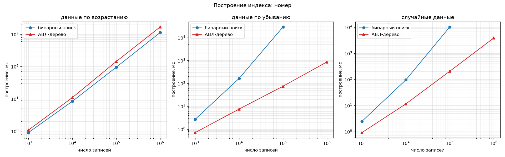
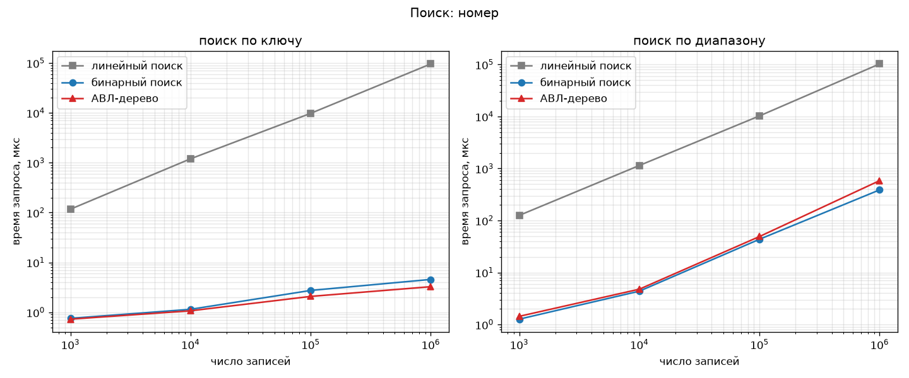
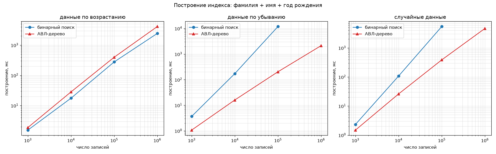
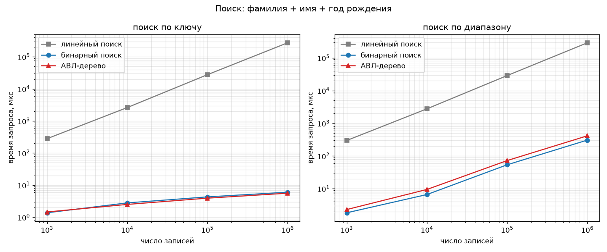

# Замеры: сравнение методов поиска

Программа `lab2_bench` (DESIGN.md, п. 3.3 «Замеры», п. 4.9) строит индексы тремя методами на одних и тех же данных и сохраняет время в [results/results.csv](results/results.csv). Скрипт [plot.py](plot.py) строит по CSV графики. Полный вывод последнего запуска лежит в [results/benchmark_log.txt](results/benchmark_log.txt).

## Как запустить

Замеры имеют смысл только в сборке **Release**: в Debug нет оптимизаций, и время получается в несколько раз больше.

```bash
cmake --preset release && cmake --build --preset release
./build/release/bench/lab2_bench            # полный эксперимент, ~2–3 минуты
./build/release/bench/lab2_bench --quick    # только 10³ и 10⁴, секунды
python bench/plot.py                        # графики в bench/results/
```

В CLion: пресет `release`, цель `lab2_bench`.

## Условия эксперимента

| Параметр | Значение |
|---|---|
| Атрибуты | «номер» (все ключи разные); «фамилия + имя + год рождения» (78 379 разных ключей на 10⁵ записей, 194 798 на 10⁶) |
| Размеры | 10³, 10⁴, 10⁵, 10⁶ записей |
| Порядок данных | по возрастанию ключа, по убыванию, случайный (одни и те же люди, разложенные по-разному) |
| Построение | медиана из 3 повторов; построение дольше 1 с не повторяется |
| Поиск по ключу | 1000 запросов по ключам существующих записей (у линейного — 5), среднее время запроса |
| Поиск по диапазону | диапазоны между соседними ключами случайной выборки из 1000 записей, то есть в среднем n/1000 найденных записей |
| Пропуски | бинарный поиск на данных по убыванию и случайных при n > 10⁵: построение O(n²) заняло бы десятки минут |
| Машина | WSL 2 (Ubuntu), GCC 15, `-O3`; seed 2024 |

## Результаты: атрибут «номер»

Время построения индекса, мс:

| n | порядок | бинарный поиск | АВЛ-дерево |
|---|---|---:|---:|
| 10⁴ | по возрастанию | 8,4 | 10,9 |
| 10⁴ | по убыванию | 165 | 7,6 |
| 10⁴ | случайный | 95 | 11,4 |
| 10⁵ | по возрастанию | 95 | 143 |
| 10⁵ | по убыванию | **29 292** | 75 |
| 10⁵ | случайный | **10 207** | 204 |
| 10⁶ | по возрастанию | 1 126 | 1 677 |
| 10⁶ | по убыванию | пропущен | 870 |
| 10⁶ | случайный | пропущен | 3 835 |

Время одного запроса при n = 10⁶, мкс:

| Метод | по ключу | по диапазону (≈1000 найденных) |
|---|---:|---:|
| Линейный поиск | ≈ 96 000 | ≈ 103 000 |
| Бинарный поиск | 4,6 | 388 |
| АВЛ-дерево | 2,9–3,9 | 434–819 |




## Результаты: атрибут «фамилия + имя + год рождения»




Картина та же. Всё в 1,5–3 раза медленнее, потому что сравнение составного ключа дороже сравнения числа: сначала сравниваются строки, потом год.

## Выводы

1. **Индекс окупается сразу.** При n = 10⁶ запрос по ключу через индекс занимает единицы микросекунд, а линейный поиск около 0,1 с, то есть в 20–30 тысяч раз дольше. Время линейного поиска растёт пропорционально n (прямая с наклоном 1 на логарифмическом графике), время индексов почти не растёт (O(log n)). Если запросов к одной коллекции больше нескольких десятков, построение индекса окупается.

2. **Порядок исходных данных решает судьбу отсортированной последовательности** (сноска 1 задания). Новый ключ вставляется после бинарного поиска места, и хвост массива сдвигается:
   - по возрастанию каждый ключ встаёт в конец, сдвигов нет: O(n log n), это самое быстрое построение из всех;
   - по убыванию каждый ключ встаёт в начало и сдвигает всё: O(n²). При переходе от 10⁴ к 10⁵ время выросло в 177 раз, а не в 10;
   - на случайных данных в среднем сдвигается половина массива, поэтому время примерно вдвое меньше, чем по убыванию, но рост тоже квадратичный.

3. **АВЛ-дереву порядок данных не страшен.** Время растёт как n log n при любом порядке (в 10–19 раз при росте n в 10 раз). Без балансировки на упорядоченных данных дерево выродилось бы в список, и построение тоже стало бы O(n²).

4. **Поиск у двух индексов одинаково быстрый**: O(log n), единицы микросекунд. Бинарный поиск чуть выигрывает на диапазонах: найденные ключи лежат в массиве подряд, а у дерева разбросаны по памяти.

5. **Время диапазона растёт с n, потому что растёт k.** Ширина диапазонов выбрана так, что находится около n/1000 записей. Время — это O(log n) на поиск начала плюс O(k log k) на выдачу и упорядочивание позиций, и второе слагаемое главное.

### Два неочевидных эффекта (к защите)

- **АВЛ-дерево на возрастающих данных строится вдвое дольше, чем на убывающих**, хотя случаи симметричны. Дело в сравнениях: спуск сначала проверяет `ключ < узел`, затем `узел < ключ`. При спуске влево (убывающие данные) хватает первой проверки, при спуске вправо (возрастающие) нужны обе. Значит, сравнений на каждом уровне вдвое больше.
- **На случайных данных АВЛ-дерево медленнее, чем на упорядоченных** (3,8 с против 0,9–1,7 с при 10⁶), хотя асимптотика одна. Упорядоченные вставки всё время проходят по одному краю дерева, и эти узлы лежат в кэше процессора. Случайные вставки обращаются к случайным узлам по всей памяти, и почти каждый переход по указателю — промах кэша.

### Что выбрать

| Ситуация | Метод |
|---|---|
| Несколько запросов к маленькой коллекции | линейный поиск: ничего не строится |
| Данные приходят уже упорядоченными, потом только читаются | бинарный поиск: самое быстрое построение и компактная память |
| Данные в произвольном порядке, записи добавляются | АВЛ-дерево: O(log n) на вставку при любом порядке |
